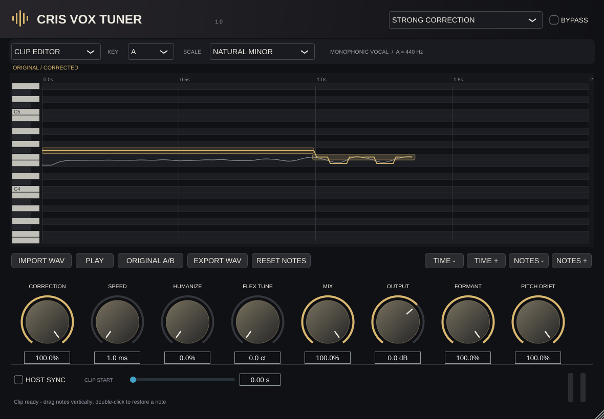

# CRIS VOX TUNER 1.0

Afinador vocal monofónico en C++17 y JUCE 8. Interfaz negra y dorada, corrección automática, edición de notas de una grabación y presets urbanos. Proyecto independiente: no usa ni modifica CRIS VOX ENHANCER.

**Estado: primera versión funcional de desarrollo.** Compilada y comprobada en Linux. La compilación nativa para Windows y los artefactos descargables están configurados en GitHub Actions; su primera ejecución en tu repositorio y las pruebas en FL Studio siguen pendientes. No se presenta como un producto profesional ya validado.



## Qué incluye

- VST3 y aplicación standalone; entradas y salidas mono o estéreo vinculadas.
- LIVE INPUT: afinación de la señal del mezclador, sin importar archivos.
- CLIP EDITOR: importar WAV/AIFF/FLAC, analizar, mover notas, comparar original/corregido y exportar WAV de 24 bits.
- F0 mediante YIN, filtro de confianza, seguimiento, notas sostenidas y conservación ajustable de variaciones.
- Transformación espectral real mediante Signalsmith Stretch con compensación de formantes.
- Automatización de parámetros, nueve presets y recuperación del estado con rutas de audio y ediciones.
- Corrección, velocidad, humanize, tolerancia, formantes, pitch drift, tonalidad, escala, mezcla, salida y bypass.
- Análisis y render de clips en un hilo de baja prioridad; memoria preasignada en el motor LIVE y lectura de clips sin mutex en el callback.
- Pruebas DSP, integración, render de una muestra cantada y generación de capturas de la interfaz real.

Los presets inspirados en Duki, Anuel AA y Bad Bunny son ajustes originales de corrección. No son presets oficiales ni modelos de sus voces. No hay clonación vocal. La tonalidad y escala se eligen para cada canción. Este afinador no añade compresión, ecualización, reverb ni delay.

## Estructura

| Ruta | Contenido |
|---|---|
| `CMakeLists.txt` | Dependencias con commits fijos, plugin, standalone y pruebas |
| `Source/PluginProcessor.h` y `.cpp` | AudioProcessor, automatización, estado, LIVE/CLIP |
| `Source/PluginEditor.h` y `.cpp` | Interfaz, controles, importación y exportación |
| `Source/dsp/PitchDetector.*` | Detección YIN de 55–700 Hz |
| `Source/dsp/PitchTracker.*` | Seguimiento y segmentación |
| `Source/dsp/PitchCorrection.*` | Escalas, objetivos, tolerancia y suavizado |
| `Source/dsp/FormantProcessor.*` | Adaptador de pitch shifting y formantes |
| `Source/dsp/VocalEngine.*` | Motor LIVE y análisis/render offline |
| `Source/model/ClipService.*` | Trabajo en segundo plano, snapshots y exportación |
| `Source/model/PresetManager.h` | Nueve presets con parámetros reales |
| `Source/ui/PitchEditor.*` | Piano roll, selección, edición y zoom |
| `tests/` | Pruebas ejecutables DSP e integración |
| `.github/workflows/build.yml` | Compilación Windows/Linux y artefactos |
| `scripts/package-windows.ps1` | Empaquetado de binarios Windows |
| `docs/` | DSP, presets, instalación, validación y límites |
| `licenses/` | Avisos de dependencias |

## La forma más sencilla: compilar en GitHub

1. Extrae el ZIP de fuentes. Sube **el contenido** de `CRIS-VOX-TUNER` a un repositorio nuevo, con `CMakeLists.txt` en la raíz. Incluye las carpetas ocultas `.github` y los archivos `.gitignore`/`.gitattributes`.
2. Abre la pestaña **Actions** del repositorio. Activa los workflows si GitHub lo solicita.
3. Ejecuta **Build, test and package CRIS VOX TUNER → Run workflow**, o espera la ejecución iniciada por el primer push.
4. Cuando termine en verde, abre esa ejecución y baja el artefacto **CRIS-VOX-TUNER-Windows-x64**. En GitHub, “Artifacts” son archivos que la compilación deja listos para descargar; no son lo mismo que una publicación en Releases.
5. Extrae el artefacto. Encontrarás `VST3/CRIS VOX TUNER.vst3` y `Standalone/CRIS VOX TUNER.exe`.
6. Sigue [la instalación en FL Studio](docs/FL_STUDIO.md).

El workflow también genera un ZIP de fuentes y un artefacto con resultados de pruebas. No publica automáticamente Releases ni sube nada a un repositorio ajeno. Una configuración de Actions no significa que una compilación Windows ya se haya ejecutado.

Para subir con Git desde PowerShell, dentro de la carpeta del proyecto:

```powershell
git init
git add .
git commit -m "Initial CRIS VOX TUNER development version"
git branch -M main
```

Después agrega la URL real de tu repositorio como `origin` y realiza `git push -u origin main`. No incluyas carpetas `build`, grabaciones privadas ni el ZIP de binarios en las fuentes.

## Compilar en Windows x64

Instala Git, CMake 3.24 o superior y Visual Studio 2022 con **Desktop development with C++**, MSVC v143 y Windows SDK. No necesitas Projucer ni un SDK VST2.

En PowerShell, desde la raíz:

```powershell
cmake -S . -B build -G "Visual Studio 17 2022" -A x64 -DCRIS_BUILD_TESTS=ON
cmake --build build --config Release --parallel 2
ctest --test-dir build -C Release --output-on-failure
./scripts/package-windows.ps1 -BuildDirectory build -Destination dist/windows
```

La primera configuración descarga JUCE 8.0.13, Signalsmith Stretch y Signalsmith Linear desde sus repositorios oficiales, en los commits fijados en CMake. Se necesita conexión a Internet. Las bibliotecas se compilan desde fuentes; no se incluyen binarios externos ocultos.

Salida VST3:

```text
build/CrisVoxTuner_artefacts/Release/VST3/CRIS VOX TUNER.vst3
```

**Copia el bundle `.vst3` completo**, incluyendo su carpeta `Contents`. No renombres una DLL para convertirla en VST3. Usa Release para mezclar: Debug no representa el rendimiento final.

## Uso rápido

### Afinar una pista existente

1. Inserta el plugin en el canal de la voz y deja `LIVE INPUT` seleccionado.
2. Selecciona la tonalidad y escala de la canción. `CHROMATIC` permite las doce notas; no detecta la tonalidad automáticamente.
3. Empieza con `NATURAL MALE VOCAL`. Para un enganche urbano más evidente, prueba `TRAP MELODIC` o uno de los tres presets inspirados.
4. Ajusta CORRECTION, SPEED y HUMANIZE. Menos milisegundos significa respuesta más rápida.
5. Deja FORMANT en 100% para compensar el desplazamiento del timbre. Ajusta MIX sin duplicar el procesador.

### Editar una grabación

1. Usa `IMPORT WAV` o arrastra un archivo al plugin. Se activa `CLIP EDITOR`.
2. Espera el análisis y render. El audio se analiza una vez; los cambios de parámetros reutilizan el análisis.
3. Pulsa PLAY para escuchar desde el inicio. STOP detiene; la siguiente reproducción empieza desde el principio.
4. Arrastra una nota verticalmente. Shift permite pasos de 10 cents; flechas arriba/abajo cambian un semitono. Doble clic o Supr restaura el objetivo automático de esa nota.
5. TIME +/− y NOTES +/− hacen zoom. La rueda desplaza el tiempo; Shift+rueda hace zoom horizontal y Ctrl+rueda vertical.
6. ORIGINAL A/B compara con el original, con volumen de salida aplicado. MIX combina el original alineado y el render.
7. EXPORT WAV guarda el resultado a la frecuencia del archivo original. Observa el mensaje de exportación completada.

El archivo de origen se guarda **por ruta**, no incrustado en el proyecto del DAW. Mantén el WAV en una carpeta estable junto con tu sesión. Tras abrir una sesión, el render se reconstruye en segundo plano. Si el archivo falta, vuelve a importarlo. Usa EXPORT para crear una versión de audio permanente.

## Latencia y CPU

El modo LIVE usa una ventana espectral de 80 ms, un intervalo de 20 ms y trabajo repartido. Reporta al host la latencia exacta de la biblioteca; en la configuración probada es aproximadamente 100 ms. Es un diseño para mezcla/postproducción, no monitorización de baja latencia al grabar.

MIX no crea otro motor de afinación: mezcla el original retardado con una única salida procesada. CLIP reproduce buffers ya renderizados. Cambiar una nota o un ajuste de afinación solicita un nuevo render en segundo plano; durante ese trabajo sigue disponible el render anterior.

Las mediciones locales y sus condiciones están en [VALIDATION.md](docs/VALIDATION.md). No garantizan ausencia de picos en cualquier equipo ni sustituyen una sesión real en FL Studio.

## Compilar solo las pruebas DSP

```powershell
cmake -S . -B build-dsp -DCRIS_BUILD_PLUGIN=OFF -DCRIS_BUILD_TESTS=ON -DCMAKE_BUILD_TYPE=Release
cmake --build build-dsp --config Release
ctest --test-dir build-dsp -C Release --output-on-failure
```

Para Linux instala las dependencias indicadas en el workflow, configura con Ninja y ejecuta las pruebas gráficas bajo X11 o `xvfb-run -a`. El VST3 Linux no sirve para FL Studio en Windows.

## Calidad, límites y licencia

Lee [DSP](docs/DSP.md), [presets](docs/PRESETS.md), [límites y pruebas pendientes](docs/LIMITATIONS.md) y [validación](docs/VALIDATION.md). El enfoque prioriza voz solista limpia; no separa voces de instrumentales ni corrige acordes.

Las fuentes de este proyecto se entregan bajo AGPL-3.0-only; consulta `LICENSE`. Las dependencias conservan sus propios avisos en `THIRD_PARTY.md` y `licenses/`. No se incluye una licencia comercial de JUCE.
